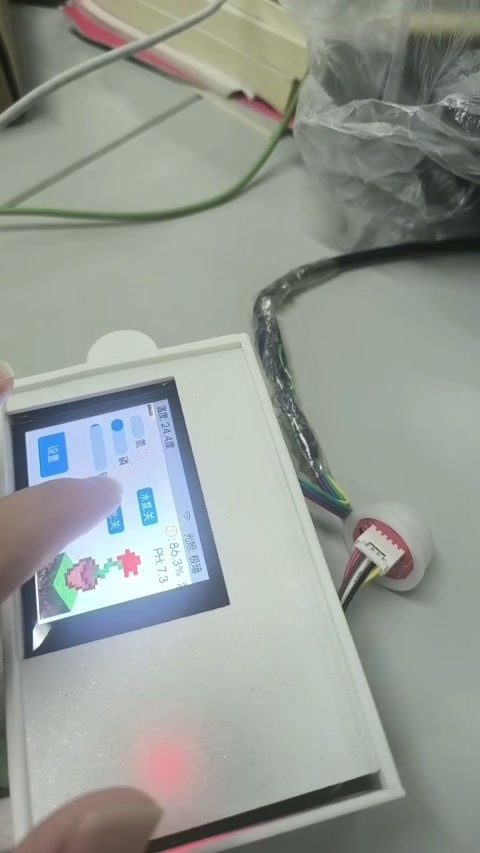
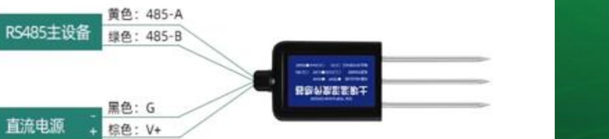

# 壤芯智栽 · ESP32 端

中国大学生计算机设计大赛 · 物联网应用 / 数字生活 参赛作品，省三等奖。

这是一个 8 人团队作品：Web 平台、小程序、后端微服务、YOLOv8 模型由队友负责，**我负责 ESP32 这一端的硬件和固件**——土壤传感器采集、LVGL 触摸界面、执行器控制、MQTT 上报、BLE 配网。

所以这个仓库只放硬件端代码，树莓派推理和 Web 端不在里面。

---

## 实物



装进外壳的整机。屏幕上是 LVGL 界面：顶部湿度 24.4%，右侧光照 86.9%、PH 值 7.3，左边三条竖条是氮 / 磷 / 钾，下面两个按钮手动控制水泵和补光灯。照片里正在用手指点屏幕，触摸是通的。

右侧那个白色探头就是土壤传感器（工业级 RS485 五插针），通过屏蔽线接到设备背面。

接线定义：



- 黄色 → 485-A
- 绿色 → 485-B
- 黑色 → GND
- 棕色 → V+（直流电源正）

---

## 整体架构

ESP32 负责感知和执行，树莓派负责视觉推理，两边通过 USB CDC 通信。

```
┌─────────────────────────────┐         ┌──────────────────────────────┐
│        树莓派 5 (RPi5)       │         │         ESP32-S3             │
│                             │         │                              │
│  picamera2 / OpenCV         │         │  ┌────────────────────────┐  │
│        ↓                    │  USB    │  │  LVGL9 UI (多级页面栈)  │  │
│  640x480 @15fps             │  CDC    │  │  ILI9341 + FT6x36      │  │
│        ↓                    │ ──────► │  └────────────────────────┘  │
│  NCNN 推理 (320x320)         │  JSON   │  ┌────────────────────────┐  │
│        ↓                    │  一行    │  │ BH1750 光照 (I2C)      │  │
│  病害类别 + 置信度            │  一帧    │  │ RS485 土壤多参数 (UART1)│  │
│                             │         │  └────────────────────────┘  │
└─────────────────────────────┘         │  ┌────────────────────────┐  │
                                        │  │ 继电器: 水泵 / 补光灯   │  │
                    ┌───────────────┐   │  └────────────────────────┘  │
                    │  MQTT Broker  │◄──┤  ┌────────────────────────┐  │
                    │  (TLS)        │   │  │ BLE 配网 + Wi-Fi 重连   │  │
                    └───────────────┘   │  └────────────────────────┘  │
                                        └──────────────────────────────┘
```

---

## 硬件组成

| 模块 | 型号 | 接口 | 引脚 / 地址 |
|---|---|---|---|
| 主控 | ESP32-S3 | — | — |
| 显示屏 | ILI9341 | SPI | SCLK=GPIO11, MOSI=GPIO12, CS=GPIO10, DC=GPIO13, RST=GPIO9, BL=GPIO5 |
| 触摸 | FT6x36 | I2C | SCL=GPIO4, SDA=GPIO5, 地址 `0x38` |
| 光照 | BH1750 | I2C | SCL=GPIO4, SDA=GPIO5, 地址 `0x23` |
| 土壤多参数 | 兆泰盛五插针（RS485） | UART1 | TX=GPIO17, RX=GPIO18 |
| 水泵继电器 | — | GPIO | GPIO15 |
| 补光灯继电器 | — | GPIO | GPIO16 |
| 调试串口 | — | UART0 | TX0 / RX0 |
| 边缘推理 | 树莓派 5 + 摄像头 | USB CDC | `/dev/ttyACM0` |

> 引脚分配与 I2C 地址详见 [`docs/hardware_modules_table.csv`](docs/hardware_modules_table.csv)
> 土壤传感器手册：[`兆泰盛五插针土壤多参数传感器.pdf`](兆泰盛五插针土壤多参数传感器.pdf)

---

## ESP32 端做了什么

- **土壤采集**：RS485 半双工，自写 Modbus RTU 主机帧（0x03 读保持寄存器），一次读 8 个寄存器拿到温度、水分、电导率、PH、氮磷钾等
- **光照采集**：BH1750，I2C 直接读，不走第三方库
- **滤波**：每个通道 5 点滑动窗口中值，把 RS485 偶发错帧和电源抖动带来的跳变压掉
- **本地界面**：LVGL9，多级页面栈（栈里存页面指针实现「返回上一级」，避免 LVGL 动态页面指针失效），触摸用 FT6x36
- **执行器**：两个继电器，界面按钮手动开关，也留了自动模式的接口
- **网络**：BLE 配网（首次），Wi-Fi 断线自动重连，MQTT over TLS 按设备 ID 分主题上报 JSON
- **边缘结果接收**：树莓派通过 USB CDC 回传病害识别结果，ESP32 按括号深度解析一行一个 JSON，只保留最近一个合法帧

### USB CDC 通信协议

树莓派 → ESP32，一行一个 JSON，UTF-8，`\n` 结尾：

```json
{"type":"infer","label":"番茄早疫病叶","conf":0.87,"ts":1715769600}
```

接收端不用固定长度读，按括号深度判断 JSON 边界——因为串口一次 read 可能拿到半帧，也可能一次拿到两帧。树莓派侧带 3 秒重试，串口拔了插回来能自动恢复。

---

## 目录结构

```
main/
  main.c                    # 入口、任务初始化
  ble_sitting_wifi/         # BLE 配网
  uart_echo_wifi_ble/       # 串口 / Wi-Fi / BLE 通信、MQTT 上报
  esp_lcd_touch_ft6x36/     # FT6x36 触摸驱动组件
  ui/                       # LVGL 界面（generated + custom + events）
docs/
  hardware_modules_table.csv
  images/                   # 实物照片、接线图
partitions.csv              # 分区表（预留 OTA 槽位）
sdkconfig
```

树莓派端的推理代码也在仓库里（`raspberry_pi_code/`），那部分是队友做的，我留在这里只是为了让整个链路能跑通、方便复现。

---

## 编译

```bash
# 需要 ESP-IDF v5.x
idf.py set-target esp32s3
idf.py menuconfig        # 配置 Wi-Fi / MQTT 参数
idf.py build
idf.py -p <PORT> flash monitor
```

---

## 踩过的坑

### FT6x36 触摸驱动

官方组件仓库里没有现成的 FT6x36 组件（只有 FT5x06），只能自己按 IDF 的 `esp_lcd_touch` 接口写一个。踩的点：

- 触摸坐标和屏幕坐标方向不一致，需要在驱动里做一次映射，否则点左边响应右边
- I2C 读的时候要一次性把 x/y/事件标志读出来，分两次读会出现 x 是旧的、y 是新的

### LVGL 页面栈

一开始用 `lv_scr_load` 切页，切几次之后返回上一级就崩。原因是页面对象被 LVGL 回收了，栈里存的指针成了野指针。

改成自己维护一个 `lv_obj_t*` 栈，切页时只改可见性不销毁对象，问题消失。代价是内存占用高一点（所有页面常驻），但 S3 有 8 MB PSRAM，无所谓。

### RS485 收发方向

半双工，DE 引脚控制方向。最初发完立刻拉低 DE，从站收到的是残帧。必须 `uart_wait_tx_done()` 等移位寄存器真的空了再切回接收。

9600 波特率下 8 字节要 8.3 ms，而 `uart_write_bytes` 返回只要几十微秒。

### 摄像头识别失败

树莓派 5 的摄像头链路和旧版差别很大，遇到过设备不识别、驱动加载异常。排查过程写在 [`raspberry_pi_code/CAMERA_TROUBLESHOOT.md`](raspberry_pi_code/CAMERA_TROUBLESHOOT.md)（这部分是队友处理的，我只是把文档留档）。

---

## 团队分工

| 部分 | 负责人 |
|---|---|
| **ESP32 硬件 + 固件**（采集、LVGL、执行器、通信） | **朱森** |
| Web 前端（Vue3） | 队友 |
| 小程序 | 队友 |
| 后端微服务（SpringBoot） | 队友 |
| YOLOv8 模型训练与部署 | 队友 |
| 树莓派推理链路 | 队友 |
| 文档、答辩材料 | 全队 |

参赛提交的材料里分工表是按「组织协调 / 作品创意 / 技术实现 / 测试分析」这类维度均摊填的，没有按模块细分，所以看不出谁写了哪块代码。实际情况是各人负责各自的模块，硬件端从选型、接线、驱动到固件都是我一个人做的。

---

## TODO

- [ ] 实现 OTA 远程升级（分区表已预留槽位）
- [ ] 自动模式：按土壤湿度阈值自动开水泵
- [ ] 低功耗：目前一直跑，没做休眠
